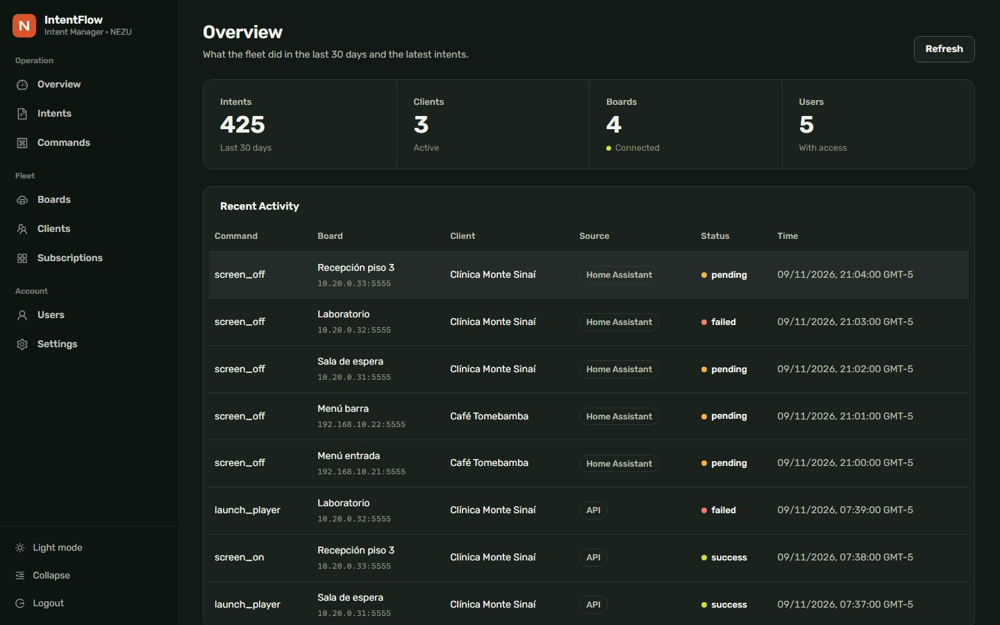
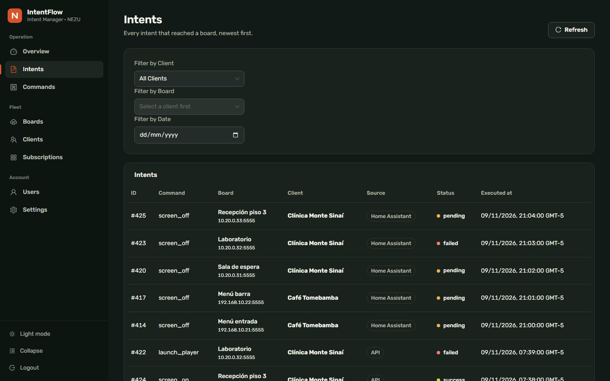
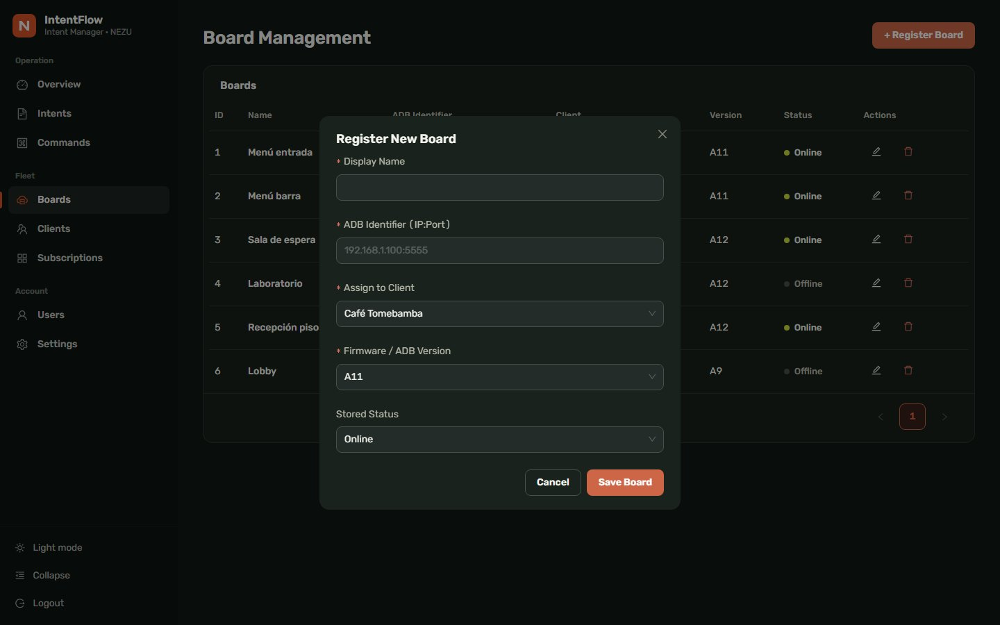
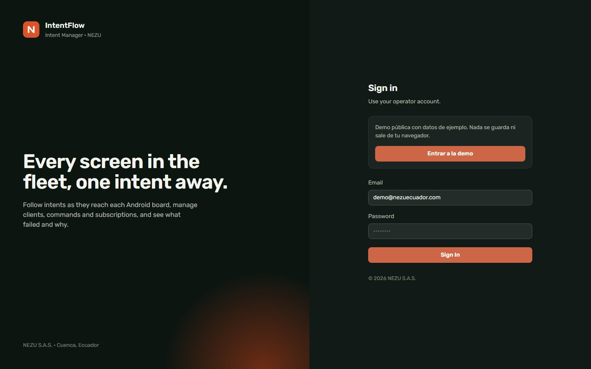
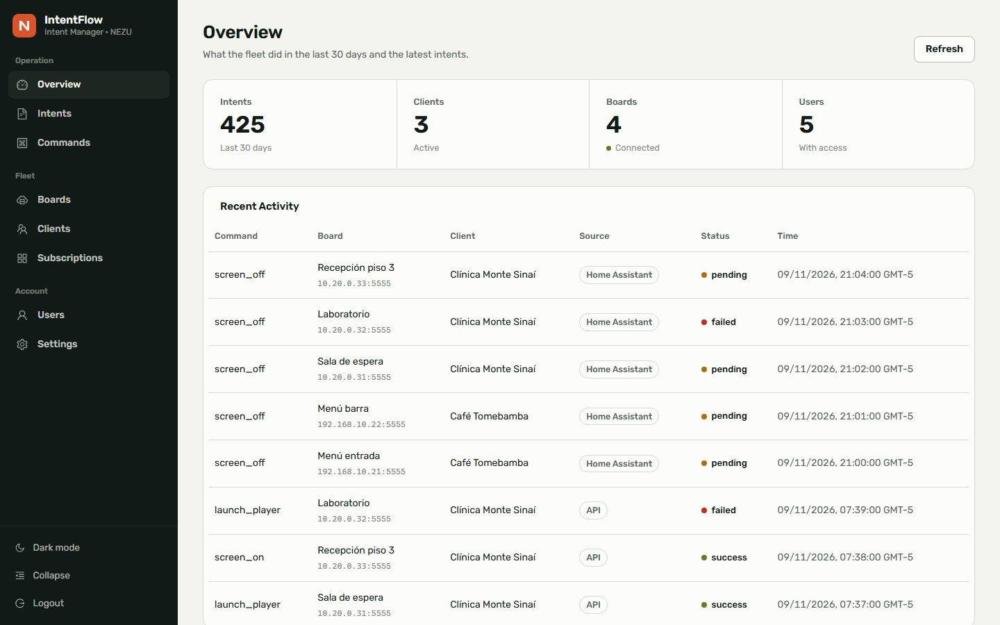

<div align="center">
  
</div>

# IntentFlow Dashboard

> **In English.** The admin dashboard of NEZU's Intent Manager: intents, Android boards, commands, clients, users and subscriptions. The backend is private, but a public demo with sample data runs entirely in the browser. Feature-sliced architecture (domain · application · infrastructure per feature), services injected through a composition root, data loading through a small `useQuery` hook that never sets state synchronously in effects, NEZU design system (ink and paper neutrals, orange primary, Rubik, light and dark), 118 tests with Vitest, zero known vulnerabilities, single `main` branch. Next.js 16, React 19 and Ant Design.

Panel administrativo del **Nezu Intent Manager**, el servicio que recibe intenciones, las traduce en comandos y las sincroniza con las placas y dispositivos del ecosistema NEZU. Desde este panel el operador ve el estado de las intenciones, administra placas, clientes, usuarios y suscripciones, revisa comandos y ajusta la configuración.

El backend (API en Django) es privado. Este repositorio contiene solo la interfaz.

## Secciones

| Ruta | Contenido |
|---|---|
| `/login` | Acceso |
| `/dashboard` | Resumen y actividad |
| `/dashboard/intents` | Intenciones y su estado |
| `/dashboard/boards` | Placas y dispositivos |
| `/dashboard/commands` | Comandos emitidos |
| `/dashboard/clients` | Clientes |
| `/dashboard/users` | Usuarios |
| `/dashboard/subscriptions` | Suscripciones |
| `/dashboard/settings` | Configuración |

## Demo pública

No hace falta el backend para ver el panel: la [**demo en línea**](https://nezusas.github.io/intentflow-dashboard/) corre con datos de ejemplo (tres clientes, seis pantallas, un mes de actividad) y permite recorrer todas las secciones, crear, editar y borrar registros. Todo ocurre en el navegador; nada se guarda ni se envía.



| Intenciones | Placas y alta de una placa |
|---|---|
|  |  |

| Acceso | Modo claro |
|---|---|
|  |  |

Para levantarla en local:

```bash
NEXT_PUBLIC_DEMO=1 npm run dev
```

La demo se construye con `npm run build:demo`: una exportación estática de Next.js con `NEXT_PUBLIC_DEMO=1` (ruta base `/intentflow-dashboard`, configurable con `NEXT_PUBLIC_BASE_PATH`) que queda en `docs/`, de donde GitHub Pages la sirve desde la rama `main`. El repositorio tiene una sola rama. Los datos y los repositorios de la demo viven en `src/demo/`; una build normal no los usa.

## Diseño

El panel comparte identidad con [nezuecuador.com](https://nezuecuador.com) y con NEZU Kiosk: neutros con tinte verde (tinta y papel), naranja NEZU como único color de acción, lima solo para «correcto» o «activo», y Rubik como única familia tipográfica con contraste por peso. Los tokens viven en `src/shared/design-system/` y alimentan a la vez el tema de Ant Design y las hojas de estilo propias; hay modo claro y oscuro. La barra lateral agrupa la navegación por lo que hace el operador (operación, flota, cuenta); las cifras del resumen van en una sola franja; los estados son un punto de color y la palabra, no una etiqueta chillona por fila.

## Ejecutar en desarrollo

```bash
npm install
npm run dev
```

Crea `.env.local` con la URL de la API. Si no se define, el panel usa el backend local por defecto:

```env
NEXT_PUBLIC_API_URL=http://127.0.0.1:8000/api
```

El panel queda en `http://localhost:3000`.

## Calidad y construcción

```bash
npm run lint        # ESLint con las reglas de React Hooks estrictas
npm test            # Vitest: dominio, servicios, hooks y las pantallas con servicios simulados
npm run build       # Next.js build
npm start           # sirve la build
npm run build:demo  # exportación estática de la demo en docs/
```

Las pantallas cargan datos con `useQuery` y `usePagedQuery` (`src/shared/hooks/useQuery.ts`): el estado de carga se deriva de «la petición actual aún no respondió», los datos anteriores siguen visibles mientras llega la página nueva, las respuestas tardías se descartan y las listas admiten cambios optimistas. Así ninguna pantalla cambia estado de forma síncrona dentro de un efecto.

## Despliegue

Optimizado para Vercel: importa el repositorio, Vercel detecta Next.js y solo hace falta definir `NEXT_PUBLIC_API_URL` con la URL pública del backend.

## Estructura

```text
src/
  app/            rutas (App Router): login y dashboard/*
  features/       una carpeta por dominio (auth, boards, clients, commands, dashboard, intents, subscriptions, users, versions),
                  cada una con domain/ (tipos y puertos), application/ (servicios) e infrastructure/ (repositorios HTTP)
  demo/           datos de ejemplo y repositorios en memoria para la demo pública
  components/     proveedor de tema
  composition/    raíz de composición: elige repositorios reales o de demo e instancia los servicios
  contexts/       contextos de React
  core/           lógica compartida
  config/         configuración, incluida la URL de la API
  shared/         componentes de interfaz, sistema de diseño, hooks (useQuery, useLazyCatalog, useActionFeedback), formato y navegación
  utils/          apoyo
tests/            pruebas con Vitest
scripts/          build-demo.mjs: la demo para GitHub Pages
docs/             build de la demo (generada, no se edita)
```

## Tecnología

Next.js 16 (App Router) · React 19 · TypeScript · Ant Design 5 · Vitest 5 · Vercel

## ¿Lo necesitas en tu operación?

Este panel es gratuito: lo publicamos porque lo usamos en nuestros propios proyectos. Si quieres un panel así para tu operación, conectado a tus dispositivos y a tu equipo, [cuéntanos qué necesitas](https://nezuecuador.com/es/contacto) y te respondemos con una propuesta concreta. Aquí está [lo que hacemos](https://nezuecuador.com/es/servicios).

## Licencia

Licencia NEZU de uso para clientes e integradores: puedes leer, instalar y operar el código y proponer mejoras; no puedes redistribuirlo, venderlo ni usarlo para construir un producto o servicio competidor. Texto completo en [LICENSE.md](LICENSE.md).

---

<div align="center">
  <sub>Parte del ecosistema <a href="https://github.com/NezuSas">NEZU</a> · <a href="https://nezuecuador.com">nezuecuador.com</a> · © NEZU S.A.S. Publicado para clientes e integradores de NEZU.</sub>
</div>
